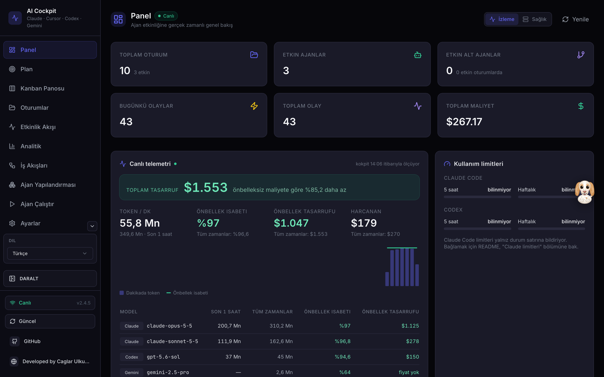
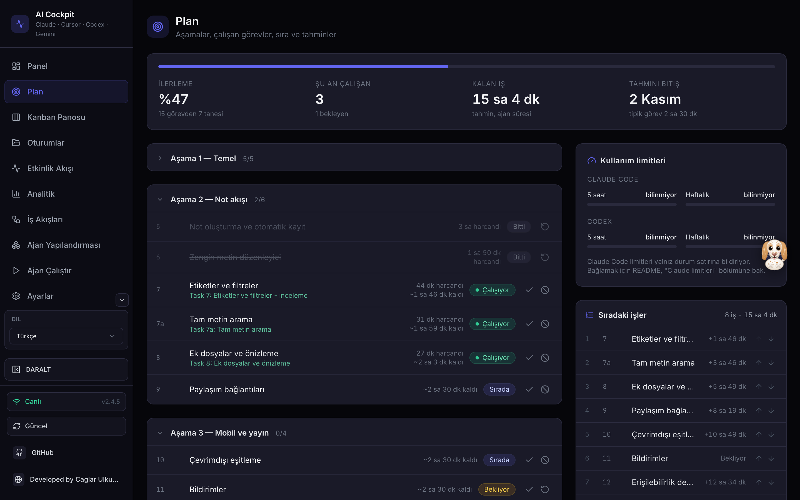
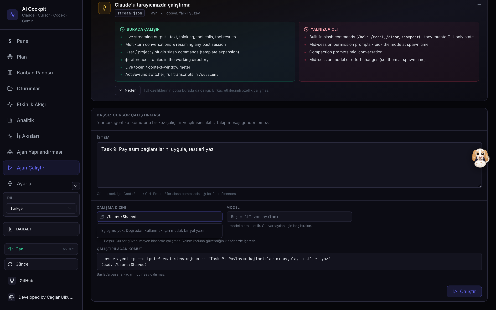
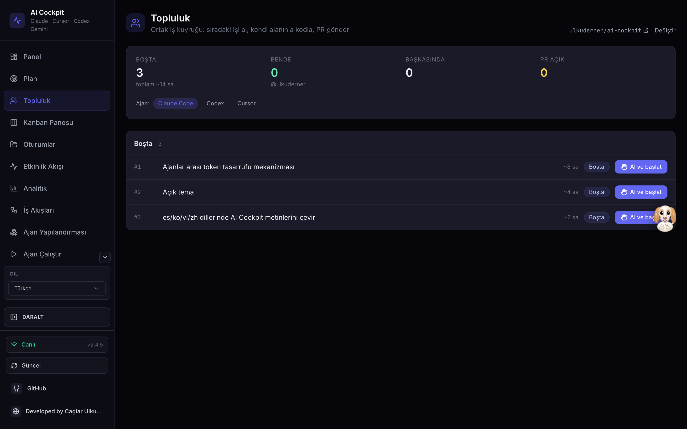
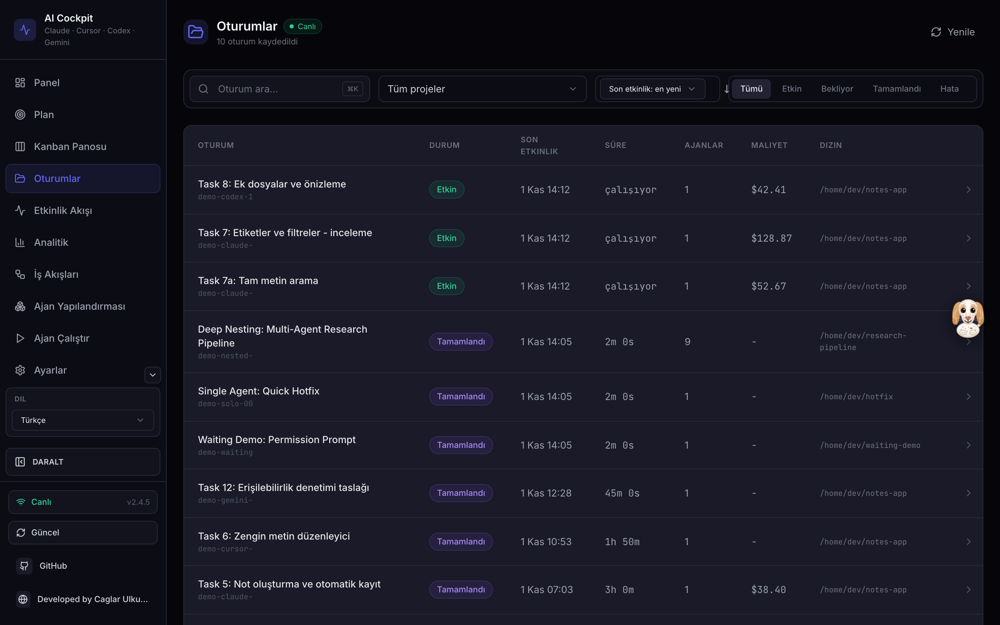
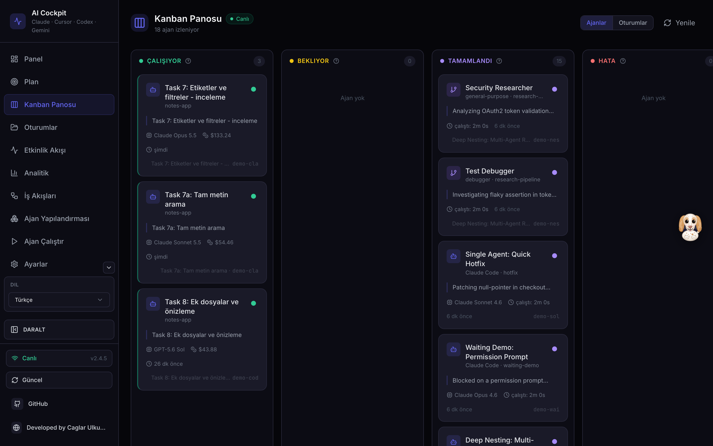

# AI Cockpit

Yapay zekâ ile kod geliştirirken çalışan ajanları tek ekranda izleme ve yönetme kokpiti. Yerel çalışır, veri makineden çıkmaz.

**Developed by Caglar Ulkuderner** · Lisans: [GPL-3.0-or-later](./LICENSE)

Adım adım ekran görüntülü kılavuz: **[docs/NASIL_KULLANILIR.md](docs/NASIL_KULLANILIR.md)**

[Claude-Code-Agent-Monitor](https://github.com/hoangsonww/Claude-Code-Agent-Monitor) (MIT, Son Nguyen) üzerine kurulu bir çatallamadır; o projenin tüm özellikleri (canlı oturumlar, alt ajan ağacı, Kanban, analiz, token/maliyet, Run) aynen durur. Aşağıdakiler AI Cockpit eklemeleridir.

<p align="center">
  <a href="images/cockpit/dashboard.png"></a>
</p>

| Plan | Ajan Çalıştır (Cursor) |
| --- | --- |
| <a href="images/cockpit/plan.png"></a> | <a href="images/cockpit/run-cursor.png"></a> |
| **Topluluk** | **Oturumlar** |
| <a href="images/cockpit/community.png"></a> | <a href="images/cockpit/sessions.png"></a> |
| **Kanban** | |
| <a href="images/cockpit/kanban.png"></a> | |

Ekran görüntüleri örnek veriyle çekildi.

## Ne ekler

- **Plan**: herhangi bir projenin plan Markdown dosyasını ekle. `#`/`##` başlıkları aşama, `### Task 3a:` / `### Görev 17c:` başlıkları görev olur. Bitti/bekliyor elle işaretlenir; "çalışıyor" otomatik gelir (çalışan bir oturumun ya da alt ajanın isteminde görev kimliği geçiyorsa). Sıradaki işler yukarı/aşağı oklarıyla sıralanır. Tahmini süreler, biten görevlerin gerçek oturum sürelerinin medyanından hesaplanır ve "tahmin" diye etiketlenir.
- **Canlı telemetri**: dakikada token, önbellek isabeti, önbellek sayesinde toplam tasarruf (API liste fiyatıyla) ve Claude, Codex/GPT, Cursor, Gemini modellerine göre kırılım; son 1 saatin dakikalık grafiği.
- **Topluluk**: GitHub Issues üzerinde ortak iş kuyruğu. `cockpit-task` etiketli açık issue'lar görevdir, `est:3h` gibi etiketler tahmini süredir. "Al ve başlat" issue'yu sana atar (başkası aldıysa reddeder), yerel klonunda `task/<no>-...` dalını açar ve Ajan Çalıştır'ı görev metniyle doldurur; ajanı sen başlatırsın. "PR gönder" önce `git push` ve `gh pr create` komutlarını ve gidecek commit'leri gösterir, onayınla `Closes #<no>` içeren PR'ı açar. Herkes kendi `gh` oturumu ve kendi AI aboneliğiyle çalışır; hesap ya da limit paylaşılmaz, dökümler hiçbir yere gitmez.
- **Fiyat senkronu**: Ayarlar'daki "LiteLLM'den senkronize et" düğmesi LiteLLM'in açık model fiyat listesini çeker ve yalnız kullandığın modellerin eksik ya da farklı fiyatlarını günceller (mevcut satırlarda hızlı mod, 1 saatlik önbellek ve uzun bağlam fiyatları korunur; Cursor kendi faturalandırmasıyla kalır). Haftada bir kendiliğinden yalnız kontrol edilir; fark varsa Panel'de uyarı çıkar. Dışarı giden tek şey fiyat listesine yapılan GET isteğidir; `AI_COCKPIT_PRICE_CHECK=0` haftalık kontrolü kapatır.
- **Topluluk ekibi**: depo bağlanınca üyeler ve rolleri (GitHub: admin/maintain/write..., GitLab: owner/maintainer/developer..., yerel: commit sahipleri) ve her birinin aktif/bitmiş görev sayısı gelir. Klon yolu "Gözat" ile ev dizini altından seçilebilir.
- **Giden istemler**: Claude alt ajanlarına ve Bash ile başlatılan Cursor, Codex, Gemini ve `claude -p` çağrılarına giden istemler; model, çalışma klasörü ve oturumla birlikte. İstem bir dosyadaysa (`"$(cat brief.md)"`) yalnız ajanın kendi çalışma klasörünün içindeki, gizli olmayan bir dosyadan en fazla 20 KB okunur.
- **Tekrar okunan dosyalar** (token tasarrufu v1): son 7 günde ajanların tekrar tekrar okuduğu dosyalar ve bunun yaklaşık bağlam tokenı maliyeti; özetleyip devir istemine ya da CLAUDE.md'ye koymak için aday listesi.
- **Plan tahmini**: ölçülmüş ajan süresi yoksa takvim temposuna düşer (plan dosyasının git'e girdiği günden bu yana geçen süre / biten görev); ekranda "takvim temposu" diye etiketlenir.
- **Dar ekran**: telefonda kenar çubuğu ikon şeridine iner, dokununca içeriğin üzerine açılır.
- **Samba**: köşedeki yardımcı, beyaz-kahverengi bir İngiliz Seteri.
- **Kullanım limitleri**: Codex 5 saatlik/haftalık limit loglardan okunur. Claude Code limitleri yalnız durum satırına bildirir; bağlamak için aşağıya bak.
- **Gemini CLI** oturumları (`~/.gemini/tmp/*/chats/session-*.json`) salt okunur içe alınır.
- **Cursor'dan ajan başlatma**: Ajan Çalıştır sayfasında Cursor seçilir; tam `cursor-agent` komutu başlatmadan önce önizlenir, "Bu klasöre güven (--trust)" açıkça işaretlenmeden güvenilmeyen klasörde çalışmaz, durdurma düğmesi vardır.
- **Türkçe arayüz** (varsayılan; es/ko/vi/zh/en de var), "AI Cockpit" adı, **açık/koyu/sistem teması** (kenar çubuğunun altında).

## Kurulum ve açma

Node 22.22+ gerekir.

```bash
git clone <bu depo> ~/ai-cockpit
ln -s ~/ai-cockpit/bin/ai-cockpit ~/.local/bin/ai-cockpit   # bir kez
ai-cockpit start      # başlatır ve tarayıcıda açar: http://localhost:4820
ai-cockpit stop       # durdurur
ai-cockpit restart    # yeniden başlatır (kod güncellemesinden sonra)
ai-cockpit status     # çalışıyor mu
```

Sunucu arka planda çalışır, terminali kapatsan da açık kalır. Log ve pid: `~/.ai-cockpit/server.log`, `~/.ai-cockpit/server.pid`. Port değiştirmek için `AI_COCKPIT_PORT=4900 ai-cockpit start`.

İlk açılışta Claude Code hook'ları `~/.claude/settings.json`'a eklenir (yalnız `localhost`'a, en geç 2.5 sn içinde biten olay gönderimi). Geliştirme modu: `DASHBOARD_UPDATE_CHECK=0 npm run dev` (http://localhost:5173).

npm kurulum betiklerinden yalnız `better-sqlite3` onaylıdır (`package.json` > `allowScripts`); `@scarf/scarf` analitik betiği çalışmaz.

## Tailscale ile uzaktan erişim

Tailscale çalışıyorsa `ai-cockpit start` kokpiti tailnet içine de açar: `https://<makine-adı>.<tailnet>.ts.net:8443`. Sunucu yine yalnız `127.0.0.1`'e bağlıdır; dışarıya açılmaz, `tailscale serve` yalnız tailnet cihazlarına HTTPS ile yönlendirir. `ai-cockpit stop` paylaşımı da kapatır.

- İlk kullanımda tailnet yönetici panelinde **Serve** (ve HTTPS sertifikaları) bir kez açılmalı; kapalıysa betik 15 sn bekleyip açma bağlantısını `~/.ai-cockpit/server.log`'a yazar.
- Kapatmak için `AI_COCKPIT_TAILSCALE=0 ai-cockpit start`, port değiştirmek için `AI_COCKPIT_TS_PORT=443`.
- Kokpitten ajan başlatılabildiği için tailnet'ini başkalarıyla paylaşıyorsan `DASHBOARD_TOKEN` ile bir erişim anahtarı tanımla.

## Başka bilgisayardan erişim ve uzak ajanlar

`ai-cockpit start` kokpiti varsayılan olarak başka cihazlara da açar. Yerel taraf `http://127.0.0.1:4820` olarak kalır (dışarıya kapalı); dış ağa **yalnız HTTPS** ile ayrı bir dinleyici açılır (`https://<ip>:4821`).

- İlk açılışta bu makinenin adı ve IP'leri için bir TLS sertifikası, bir erişim anahtarı ve bir hook anahtarı üretilir (`~/.ai-cockpit/`, yalnız senin okuyabileceğin izinlerle).
- Başlatıcı her IP için `https://<ip>:4821/#token=...` bağlantısını ve sertifikanın SHA256 parmak izini yazar. `#token` kısmı sunucuya gönderilmez; tarayıcı anahtarı saklar ve adres çubuğundan siler. Anahtarsız gelen tarayıcıya anahtar soran bir pencere çıkar.
- Tarayıcı kendi üretilmiş sertifika için bir kez uyarı verir; parmak izi aynıysa kabul et. Tailscale açıksa `https://<makine>.ts.net:8443` gerçek sertifikayla çalışır.
- `ai-cockpit start --local` yalnız o çalıştırma için kokpiti yerelde tutar.

**Uzak ajan (Go, tek dosya):** ajanların çalıştığı makinede Node ya da kokpit kurmaya gerek yok.

```bash
cd agent && ./build.sh --all          # bin/ai-cockpit-agent ve dist/ altında macOS, Linux, Windows
ai-cockpit-agent connect https://<kokpit-ip>:4821 <hook-anahtarı> <sha256-parmak-izi>
ai-cockpit-agent install              # Claude Code hook'larını ekler (önce yedek alır)
ai-cockpit-agent status
```

- Veri yalnız HTTPS ile gider; kendi üretilmiş sertifikada parmak izi zorunludur ve sertifika sabitlenir (araya giren biri taklit edemez). `.ts.net` adreslerinde sistem sertifikalarına güvenilir.
- Her olay ayrı bir süreç olarak birkaç milisaniyede gönderilir; kokpite ulaşılamazsa ajan asla beklemez.
- `ai-cockpit-agent uninstall` hook'ları, `disconnect` bağlantıyı kaldırır.

## Claude limitleri

Claude Code `rate_limits` bilgisini yalnız statusline komutuna verir. `statusline/cockpit-tee.js` girdiyi `~/.ai-cockpit/claude-limits.json`'a yazar ve mevcut statusline komutuna aynen aktarır. `~/.claude/settings.json` içinde:

```json
"statusLine": {
  "type": "command",
  "command": "node /Users/<sen>/ai-cockpit/statusline/cockpit-tee.js -- \"<önceki statusline komutun>\""
}
```

## Lisans

AI Cockpit GNU GPL v3 (veya sonraki sürümler) altındadır, bkz. [LICENSE](./LICENSE). Taban projeden gelen kod MIT lisanslıdır; özgün telif ve izin notu [LICENSE-MIT](./LICENSE-MIT) dosyasında korunur.

## Veriler nerede

- Kokpit veritabanı: `~/.claude/agent-dashboard/dashboard.db` (yerel SQLite).
- Plan listesi, elle işaretler ve sıra: `~/.ai-cockpit/plans.json`.
- GitHub güncelleme denetimi başlatıcıda kapalıdır (`DASHBOARD_UPDATE_CHECK=0`). Webhook ve push bildirimleri yalnız Ayarlar'dan açıkça kurulursa dışarı bağlanır.

## Bilinen sınırlar

- Etkileşimli Cursor sohbetlerinin içeriği `~/.cursor/chats` altında şifreli tutulduğu için okunamaz; o oturumlar listede görünür ama hangi görev üzerinde çalıştıkları algılanmaz. Kokpitten başlatılan Cursor çalıştırmaları tam görünür.

---

# Agent Dashboard for Claude Code, Cursor & Codex

### A local-first control room for AI coding agents

Monitor Claude Code, Cursor, and Codex sessions in real time. Follow conversations and tools, inspect agent hierarchies, understand token usage and cost, analyze orchestration, and operate local agents from one responsive dashboard.

> [!TIP]
> **Complete guides:** [English](./README-EN.md) · [中文](./README-CN.md) · [Tiếng Việt](./README-VN.md) · [한국어](./README-KO.md) · [Español](./README-ES.md)


<p align="center">
  <a href="images/analytics.png"></a>
  <br>
  <em>Live fleet state, active work, recent events, cost, and system health.</em>
</p>

## See what your agents are doing

CCAM combines native hooks with provider-aware transcript discovery. It stays local by default and turns agent activity into a searchable, durable operational record.

- **One live fleet:** Claude Code, Cursor, and Codex sessions appear in the same Dashboard, Sessions, Activity Feed, and Kanban views.
- **Complete conversations:** Rendered Markdown, highlighted code, tool calls, command output, queued prompts, attachments, and provider-native titles.
- **Agent orchestration:** Parent-child trees, background agents, dynamic workflow runs, tool-flow graphs, concurrency, delegation, and compaction analysis.
- **Cost and usage:** Model-aware tokens, configurable pricing, introductory rates, subagent costs, trends, and budget-friendly CLI/MCP access.
- **Run and resume agents:** Launch Claude Code or Codex, stream output, send follow-ups, resume previous work, and reattach to background runs.
- **Configuration visibility:** Inspect Claude Code and Codex settings, skills, hooks, MCP servers, rules, plugins, memory, profiles, and instructions.
- **Operational safety:** Loopback binding, optional authentication, guarded mutations, backup-first edits, bounded uploads, and no automatic self-update.
- **Team-ready delivery:** Desktop applications, containers, Kubernetes, Terraform, monitoring, alerts, webhooks, and remote data sources.

## See CCAM in action

<p align="center">
  <a href="images/session-conversation.png"></a>
  <br>
  <em>Conversation history with code, tools, reasoning, and session context.</em>
</p>

<p align="center">
  <a href="images/workflows.png"></a>
  <br>
  <em>Workflow intelligence for orchestration, delegation, tools, errors, and concurrency.</em>
</p>

<p align="center">
  <a href="images/config.png"></a>
  <br>
  <em>Provider-aware configuration, skills, hooks, plugins, MCP, rules, and memory.</em>
</p>

<p align="center">
  <a href="images/run.png"></a>
  <br>
  <em>Launch and manage Claude Code or Codex without leaving the dashboard.</em>
</p>

## Quick start

**Requirements:** Node.js 22.22 or newer and npm 9 or newer.

```bash
git clone https://github.com/hoangsonww/Claude-Code-Agent-Monitor.git
cd Claude-Code-Agent-Monitor
npm run setup
npm run dev
```

Open [http://localhost:5173](http://localhost:5173). `npm run setup` installs the root, client, and VS Code extension dependencies, builds the MCP server, and links the `ccam` CLI. On first launch, follow the dashboard prompt to install hooks for the providers you select, or run `npm run install-hooks` manually.

For production, run `npm run build && npm start` and open [http://localhost:4820](http://localhost:4820).

Before an upgrade that may recount usage, capture and compare read-only cost snapshots:

```bash
node scripts/cost-snapshot.js snapshot --out before.tsv
# Upgrade and restart CCAM, then let startup maintenance finish.
node scripts/cost-snapshot.js snapshot --out after.tsv
node scripts/cost-snapshot.js compare before.tsv after.tsv --fail-on-local-change
```

Keep these TSV files private because they contain session identifiers and ownership metadata. The guard fails when an existing local session's usage or cost changes, ownership moves to or from local, or a local session disappears; remote and newly added sessions are reported separately. See the [complete upgrade safeguard](./README-EN.md#cost-snapshots-before-an-upgrade) for the exact compared fields.

## Choose how to run CCAM

| Option | Best for | Guide |
| --- | --- | --- |
| Source checkout | Development and local customization | [Full setup guide](./README-EN.md#quick-start) |
| Desktop app | A persistent macOS or Windows app with tray controls | [Desktop guide](./DESKTOP.md) |
| Docker or Podman | Isolated local or server deployments | [Deployment guide](./DEPLOYMENT.md) |
| Kubernetes or Terraform | Production infrastructure | [Deployment reference](./docs/DEPLOYMENT.md) |
| MCP sidecar | Agent-driven dashboard queries and guarded operations | [MCP guide](./mcp/README.md) |

## Extensions and automation

CCAM ships **14 plugins**, **66 plugin skills**, **18 Claude subagents**, **34 Claude commands**, and **77 total repository skills** across Claude Code and Codex formats.

```bash
claude plugin marketplace add hoangsonww/Claude-Code-Agent-Monitor
codex plugin marketplace add hoangsonww/Claude-Code-Agent-Monitor
npx skills add hoangsonww/Claude-Code-Agent-Monitor --list
```

The `ccam` CLI and local MCP server expose sessions, agents, events, transcripts, analytics, pricing, workflows, alerts, imports, configuration, remote sources, and maintenance operations for humans and automation.

## Documentation

- **Complete product and operational reference:** [README-EN.md](./README-EN.md)
- **Documentation index:** [docs/README.md](./docs/README.md)
- **Task-oriented handbook:** [GitHub Wiki](https://github.com/hoangsonww/Claude-Code-Agent-Monitor/wiki)
- **Localized product tour:** [Static Wiki](https://hoangsonww.github.io/Claude-Code-Agent-Monitor/wiki/)
- **Architecture:** [ARCHITECTURE.md](./ARCHITECTURE.md)
- **CLI:** [docs/CLI.md](./docs/CLI.md)
- **REST and OpenAPI:** [docs/API.md](./docs/API.md)
- **Hooks and lifecycle:** [docs/HOOKS.md](./docs/HOOKS.md)
- **Database:** [docs/DATABASE.md](./docs/DATABASE.md)
- **Plugins:** [docs/PLUGINS.md](./docs/PLUGINS.md)
- **MCP:** [docs/MCP.md](./docs/MCP.md) and [mcp/README.md](./mcp/README.md)
- **Desktop application:** [DESKTOP.md](./DESKTOP.md) and [desktop/README.md](./desktop/README.md)
- **Deployment:** [DEPLOYMENT.md](./DEPLOYMENT.md) and [docs/DEPLOYMENT.md](./docs/DEPLOYMENT.md)
- **Security:** [.github/SECURITY.md](./.github/SECURITY.md)

## Local-first and secure by default

The dashboard binds to `127.0.0.1` by default. It does not require cloud credentials, and it does not transmit your transcripts or agent data to a hosted service. Optional tokens protect HTTP, WebSocket, hook, MCP, and remote-push surfaces when you deliberately expose them beyond loopback.

See the [security policy](./.github/SECURITY.md) and [full configuration reference](./README-EN.md#configuration) before enabling remote access.

## Contributing and support

- Read the [contributing guide](./.github/CONTRIBUTING.md).
- Report bugs through [GitHub Issues](https://github.com/hoangsonww/Claude-Code-Agent-Monitor/issues).
- Ask questions and share ideas in [GitHub Discussions](https://github.com/hoangsonww/Claude-Code-Agent-Monitor/discussions).
- Follow the [Code of Conduct](./.github/CODE_OF_CONDUCT.md).

## License

GPL-3.0-or-later. See [LICENSE](./LICENSE). Upstream MIT notice: [LICENSE-MIT](./LICENSE-MIT).
