# AI Cockpit nasıl kullanılır

AI Cockpit, yapay zekâ ile kod geliştirirken çalışan ajanları (Claude Code, Cursor, Codex, Gemini CLI) tek ekranda izlemeni, planın nerede olduğunu, ne kadar token ve limit harcadığını görmeni ve işi başkalarıyla paylaşmanı sağlar. Her şey kendi bilgisayarında çalışır; veri dışarı gitmez.

> Bu belgedeki ekran görüntüleri örnek bir "Notes App" projesiyle çekildi.

**İçindekiler**

1. [Kurulum ve açma](#1-kurulum-ve-açma)
2. [Panel: canlı telemetri, limitler, tekrar okumalar](#2-panel)
3. [Plan: aşamalar, sıradaki işler, tahminler](#3-plan)
4. [Giden istemler](#4-giden-istemler)
5. [Ajan Çalıştır (Cursor, Claude, Codex)](#5-ajan-çalıştır)
6. [Topluluk: ortak iş kuyruğu](#6-topluluk)
7. [Ayarlar: fiyat senkronu, dil, tema](#7-ayarlar)
8. [Başka bilgisayardan erişim ve uzak ajanlar](#8-başka-bilgisayardan-erişim-ve-uzak-ajanlar)
9. [Claude limitlerini bağlama](#9-claude-limitlerini-bağlama)
10. [Sorun giderme](#10-sorun-giderme)

---

## 1. Kurulum ve açma

Gerekenler: Node 22.22 veya üstü, git. İsteğe bağlı: `gh` (GitHub), `glab` (GitLab), `tailscale`.

```bash
git clone https://github.com/ulkuderner/ai-cockpit.git ~/ai-cockpit
mkdir -p ~/.local/bin && ln -sf ~/ai-cockpit/bin/ai-cockpit ~/.local/bin/ai-cockpit
```

Günlük kullanım:

| Komut | Ne yapar |
| --- | --- |
| `ai-cockpit start` | Başlatır ve tarayıcıda açar: `http://localhost:4820` |
| `ai-cockpit stop` | Durdurur |
| `ai-cockpit restart` | Yeniden başlatır (kod güncellemesinden sonra) |
| `ai-cockpit status` | Çalışıyor mu, hangi modda |

Sunucu arka planda çalışır, terminali kapatsan da açık kalır. Log: `~/.ai-cockpit/server.log`.

İlk açılışta hangi araçların verisini görmek istediğin sorulur (Claude Code, Codex, Cursor, Gemini ya da Tümü). Claude Code için canlı izleme kancaları (hook) kendiliğinden `~/.claude/settings.json`'a eklenir; bunlar yalnız kendi bilgisayarındaki kokpite olay gönderir ve Claude'u asla bekletmez.

## 2. Panel

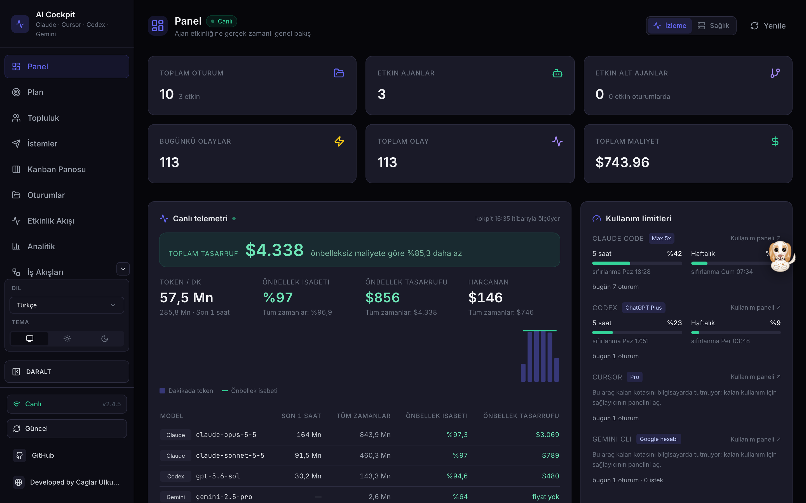

En üstte oturum, ajan, olay ve maliyet özetleri; altında canlı bölümler var.

### Canlı telemetri

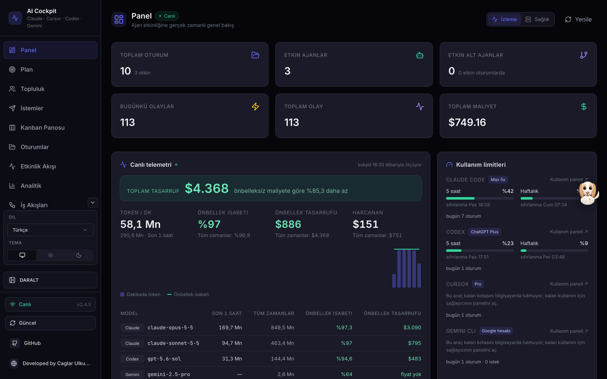

- **Toplam tasarruf** (yeşil şerit): önbellek (prompt caching) sayesinde, aynı token'lar düz girdi olarak faturalansaydı ödenecek tutara göre ne kadar tasarruf ettiğin. API liste fiyatıyla hesaplanır; aboneliğinde gerçekten ödediğin para değildir.
- **Token / dk, önbellek isabeti, önbellek tasarrufu, harcanan**: son 1 saat ve tüm zamanlar.
- **Grafik**: son 60 dakikada dakika başına token (çubuk) ve önbellek isabeti (yeşil çizgi).
- **Modele göre tablo**: Claude, Codex/GPT, Gemini modelleri ayrı ayrı. Fiyatı bilinmeyen modelde "fiyat yok" yazar; [fiyat senkronu](#7-ayarlar) bunu doldurur.

### Kullanım limitleri

Bu bilgisayarda kurulu her AI aboneliği kendiliğinden listelenir:

| Araç | Plan nereden okunur | Limit |
| --- | --- | --- |
| Claude Code | `~/.claude.json` (ör. Max 20x) | 5 saat ve haftalık, [durum satırı bağlanınca](#9-claude-limitlerini-bağlama) |
| Codex | `~/.codex/auth.json` (ör. ChatGPT Team) | 5 saat ve haftalık, Codex loglarından |
| Cursor | `cursor-agent about` (ör. Ultra) | Yerelde tutulmuyor: bugünkü oturum sayısı + "Kullanım paneli" bağlantısı |
| Gemini CLI | `~/.gemini/settings.json` | Yerelde tutulmuyor: bugünkü oturum/istek sayısı + panel bağlantısı |

Çubuk %70'i geçince sarı, %90'ı geçince kırmızı olur. Altında sıfırlanma zamanı yazar.

### Tekrar okunan dosyalar (token tasarrufu)

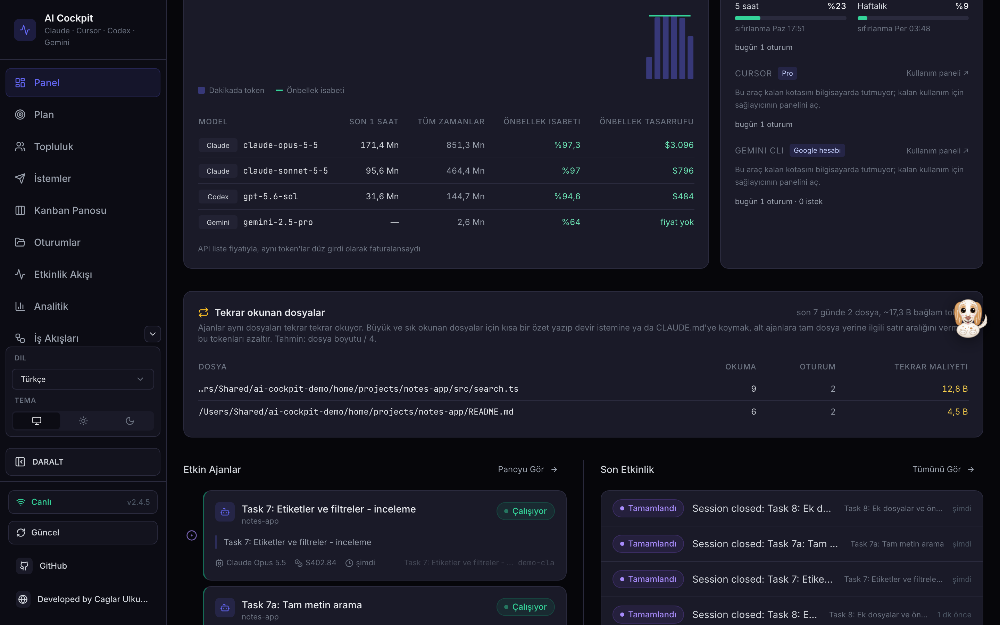

Son 7 günde ajanların tekrar tekrar okuduğu dosyalar, kaç kez, kaç oturumda ve yaklaşık kaç bağlam tokenına mal olduğu. Listenin başındaki dosyalar için:

- kısa bir özet yazıp devir istemine ya da `CLAUDE.md`'ye koy,
- alt ajanlara tam dosya yerine ilgili satır aralığını ver.

## 3. Plan

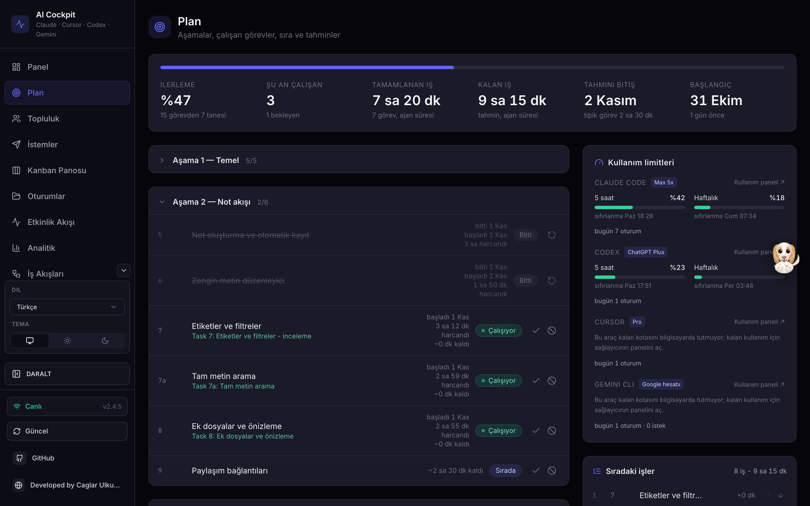

**Planlar kendiliğinden bulunur.** Son 14 günde ajanların çalıştığı her depoda (worktree'ler ana depoya sayılır) kokpit şu sırayla plan arar:

1. depodaki SDD defterinin (`.superpowers/sdd/<koşu>/plan-path`) gösterdiği plan,
2. yoksa `docs/superpowers/plans/` ya da `docs/plans/` içindeki, ya da adında "plan" geçen en yeni Markdown dosyası (en az 3 görev içermeli).

Canlı oturumu olan bir depoda plan bulunamazsa sayfa o proje için dosya yolunu sorar. Elle de ekleyebilirsin (sağ altta "Plan ekle", dosyanın tam yolu).

Plan dosyası iki biçimden birinde olabilir:

```markdown
# Aşama 1: Temel
### Task 1: Proje iskeleti ve CI (est:3h)
### Task 2: Kimlik doğrulama (est:45m)

## Aşama 2: Not akışı
### Görev 7a: Tam metin arama
```

```markdown
### M0: Depo ve araç zinciri
#### T01 · Monorepo iskeleti — 1 gün
#### T02 · Lisans dosyaları — 0,5 gün
```

- İlk biçimde `#` / `##` başlıkları **aşama**, `### Task <no>:` ya da `### Görev <no>:` başlıkları **görev** olur. Kart biçiminde `###` başlıkları aşama, `#### T<no> ·` başlıkları görevdir.
- `(est:3h)` ya da sondaki `— 1 gün` isteğe bağlı tahmindir; başlıkta görünmez, tahminde kullanılır.
- **Durumlar**: Bitti ve Bekliyor elle işaretlenir (satırdaki ✓ ve ⦸). Bitti kendiliğinden de gelir: SDD defterinde `Task 7a: complete` satırı varsa, defter yoksa görevin dalı ana dala birleştiyse (`feat/T05`, `task/12-…`) ya da commit konusu `(T01)` ile bitiyorsa. **Çalışıyor** da kendiliğinden gelir: defterde `Task 7a: dispatched` yazan ya da planın deposunda çalışan bir oturumun, alt ajanın veya giden bir istemin içinde görev numarası geçen görevler. Paralel ajanlar kendi worktree'lerinde çalışıyorsa (dal adı görev numarasıyla biter) her görev kendi oturumlarıyla görünür.
- **Sıradaki işler**: sağda, yukarı/aşağı oklarıyla sıralanır; başlıkta iş adedi ve toplam süre, her satırda birikimli süre yazar.
- **Tahminler** üç kaynaktan gelir, ekranda hangisi olduğu yazar:
  1. *plandaki tahminler*: görevde `(est:…)` ya da `— N gün` varsa o kullanılır. Gün tahminleri tek kişiye göre yazıldığı için, biten tahminli görevlerin gerçek hızıyla ölçeklenir (36 plan günü 16 takvim gününde bittiyse kalan tahminler de aynı oranda kısalır),
  2. *ajan süresi*: tahmini olmayan görevlerde, biten görevlerin gerçek oturum sürelerinin ortancası (birçok görevi anan yönetici oturumlar sayılmaz),
  3. *takvim temposu*: o da yoksa plan dosyasının git'e girdiği günden bu yana geçen süre ÷ biten görev.
- **Başlangıç**: plan dosyasının git'e girdiği gün ile ilk ölçülen oturumdan hangisi önceyse.
- Tamamlanan aşamalar kapalı gelir; tıklayınca açılır.

## 4. Giden istemler

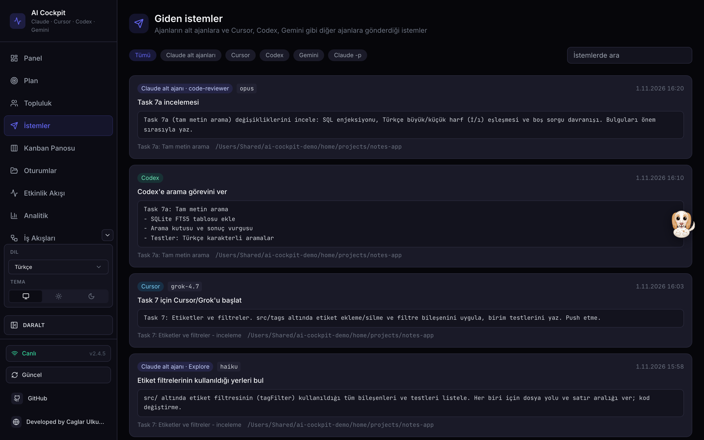

Yöneten ajanın başka ajanlara gönderdiği her istem, ana istem gibi okunabilir:

- **Claude alt ajanları** (Agent aracı): tür, açıklama, model, istem.
- **Bash ile başlatılan ajanlar**: `cursor-agent`, `codex exec`, `gemini`, `claude -p`. İstem komutun kendisinden, heredoc'tan ya da `"$(cat brief.md)"` gibi bir dosyadan çıkarılır. Dosya yalnız kokpitte ayarlı proje klasörlerinin (Plan depoları, Topluluk deposu) içindeyse okunur.

Üstteki düğmelerle türe göre süz, sağdaki kutuyla istemlerde ara. Bir oturumun ayrıntı sayfasında "Bu oturumdan giden istemler" bağlantısı yalnız o oturumunkileri gösterir.

## 5. Ajan Çalıştır

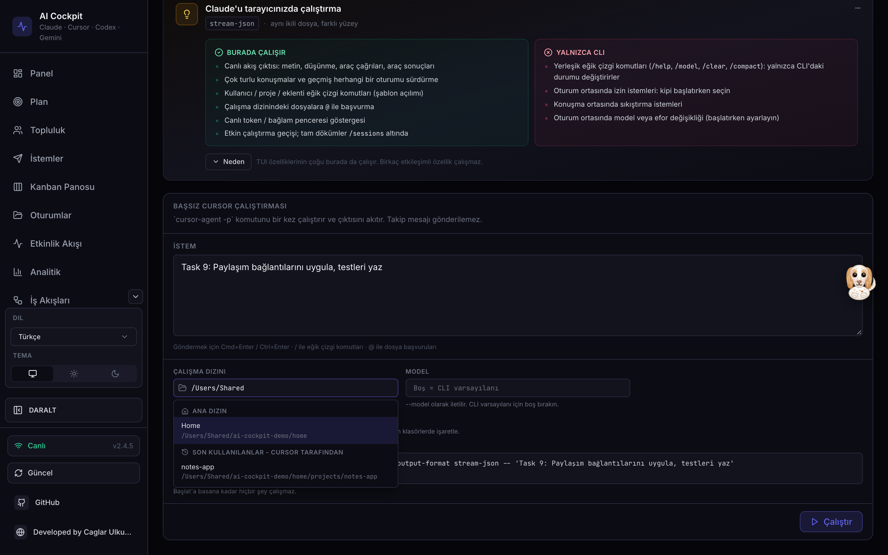

Claude Code, Codex ya da Cursor'ı kokpitten başlat:

1. Üstten ya da açılan pencereden sağlayıcıyı seç.
2. İstemi, çalışma klasörünü ve (istersen) modeli yaz.
3. **Çalıştırılacak komut** kutusunda tam komutu gör; Çalıştır'a basana kadar hiçbir şey çalışmaz.
4. Cursor güvenilmeyen klasörde çalışmayı reddeder: yalnız koduna güvendiğin klasörlerde **Bu klasöre güven (--trust)** kutusunu işaretle.
5. Çıktı canlı akar; Durdur ile kesebilirsin.

## 6. Topluluk

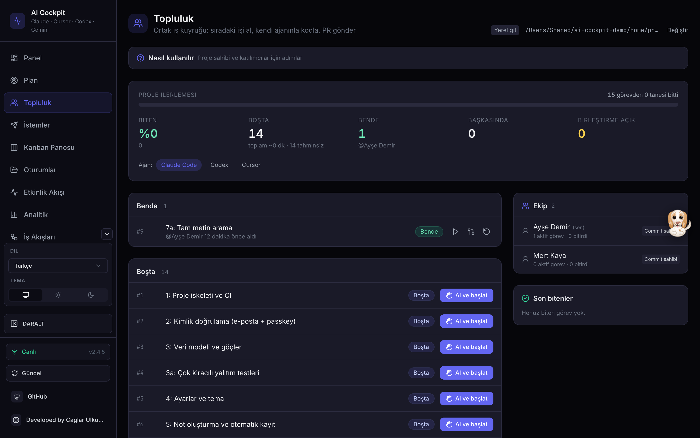

Bir projeyi birden fazla kişiyle, herkes **kendi** AI aboneliğiyle geliştirmek için ortak iş kuyruğu. Hesap ya da limit paylaşılmaz; iş paylaşılır.

Baştan sona adım adım anlatım: **[IS_TAHTASI_KILAVUZU.md](IS_TAHTASI_KILAVUZU.md)**

Sayfanın üstündeki **Nasıl kullanılır** bölümü seçtiğin platforma göre adım adım anlatır:

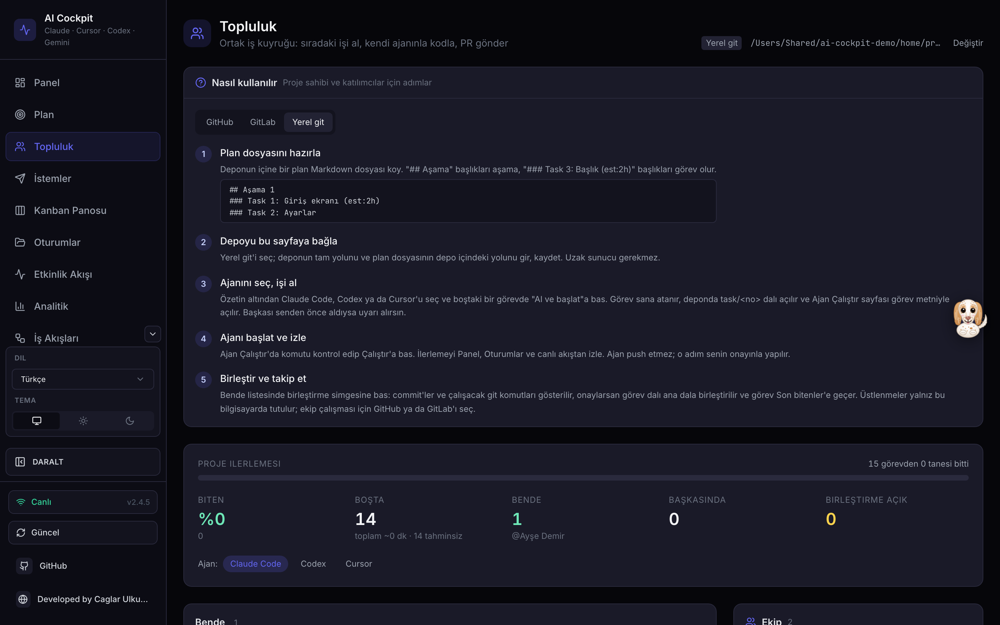

Kısaca:

| | GitHub | GitLab | Yerel git |
| --- | --- | --- | --- |
| Görevler | `cockpit-task` etiketli issue'lar | `cockpit-task` etiketli issue'lar | depodaki plan dosyası |
| Tahmin | `est:4h` etiketi ya da gövdede `est: 4h` | `est:4h` etiketi ya da gövdede `est: 4h` | başlıkta `(est:4h)` |
| Giriş | `gh auth login` | `glab auth login` | gerekmez |
| Teslim | PR (`Closes #n`) | MR (`Closes #n`) | ana dala yerel birleştirme |

**Görev alanları.** Issue gövdesine satır başında şu satırları yazarsan tahta onları okur; hiçbiri zorunlu değil, alansız eski issue'lar da alınabilir ("Alan yok" rozetiyle):

```text
Alan: server/lib/**, client/src/pages/Plan.tsx
Bağlı: #12, #14
est: 1.5h
Kabul:
- testler yeşil
- tahta açılır
```

- **Hazır**: açık, bağlı görevleri bitmiş ve alanı çalışılan bir görevle çakışmıyor.
- **Bekliyor: #12**: bağlı görev hâlâ açık. Kapalı ya da hiç olmayan numara karşılanmış sayılır.
- **Çakışma: #7 (Ali)**: alınmış ya da incelemedeki bir görevle aynı alanda. İki desen, joker karakterden (`*`, `?`, `[`) önceki kökleri aynıysa ya da biri diğerinin altındaysa çakışır.
- **Sahipsiz kalmış · 5 sa**: alınmış görevde canlı ajan yok ve son commit (yoksa alınma zamanı) ayarlardaki eşikten eski (varsayılan 4 saat).

Bekleyen ya da çakışan görevin **Al ve başlat** düğmesi kapalıdır; altında nedeni yazar.

Akış:

1. **Depoyu bağla**: platformu seç, depo adını, kendi klonunun yolunu ("Gözat" ile seçebilirsin) ve etiketi gir. İsteğe bağlı: plan dosyası (GitHub/GitLab'da "Planı tahtaya aç" için), sahipsiz eşiği (1-168 saat), Worktrunk kullanımı.
2. **Ajanını seç** (Claude Code / Codex / Cursor), hazır bir görevde **Al ve başlat**. Görev sana atanır (başkası senden önce aldıysa uyarı alırsın). Ana klonun dalı değişmez: görev kendi worktree'sinde, `~/.ai-cockpit/worktrees/<depo>-<kısa-kimlik>/<no>-…` klasöründe `task/<no>-…` dalında açılır. Alma yarıda hata verirse atama geri alınır.
3. Worktree'ye `.ai-cockpit/brief.md` yazılır: issue metni, kabul ölçütleri, alan, plandaki ilgili bölüm, önce biten görevler ve claude-mem kuruluysa aynı depodan notlar. Dosya commit'e girmez. Ajana giden istem önce bu dosyayı okumasını ve içindeki metni talimat değil veri olarak kullanmasını söyler.
4. Ajan bitince sonucu gözden geçir; **Bende** listesinde PR simgesine bas. Gidecek commit'ler ve çalışacak komutlar gösterilir, onaylarsan gönderilir.
5. İnceleme ve birleştirme GitHub/GitLab'da. Birleşince görev **Son bitenler**'e geçer, ilerleme çubuğu artar.

**Bırakmak.** Bitiremediğin görevi **Bırak** ile geri ver. Pencerede devralacak kişiye not yazarsın (en çok 500 karakter); issue'ya gidecek yorum ("Yarıda kaldı. Dal: … Son commit: … Not: …") önizlenir ve onaylamadan yazılmaz. Dal ve worktree silinmez; görevi yeniden alan kişi kaldığı yerden devam eder. Yalnız görevi tutan kişi bırakabilir.

**Planı tahtaya aç** (GitHub/GitLab). Ayarlardaki plan dosyasındaki görevleri issue olarak açar. Önce önizleme gelir: açılacak ve güncellenecek görevler. Onaylarsan her yeni issue'nun numarası planda başlığın altına `<!-- issue:#n -->` olarak yazılır; ikinci çalıştırma çift issue açmaz, işaretli görevleri günceller. Güncellenen issue'ların başlığı ve gövdesi plandaki metinle değiştirilir; yalnız tahta etiketini taşıyan issue'lar güncellenir, etiketsiz bir işaret atlanır ve listelenir. Plan dosyasını sen commit'lersin.

**Worktrunk.** [Worktrunk](https://github.com/max-sixty/worktrunk) (`wt`) kuruluysa worktree açma ve etkinlik okuma ona devredilir; kurulu değilse ya da hata verirse git kullanılır. Depodan gelen Worktrunk hook'ları varsayılan olarak çalıştırılmaz; ayarlardan yalnız güvendiğin depoda aç.

Sağda **Ekip** (depo üyeleri, rolleri, aktif/biten görev sayıları) ve **Son bitenler** (kim, ne zaman) görünür. Depoya erişimi olan herkes kendi kokpitinde aynı panoyu görür.

## 7. Ayarlar

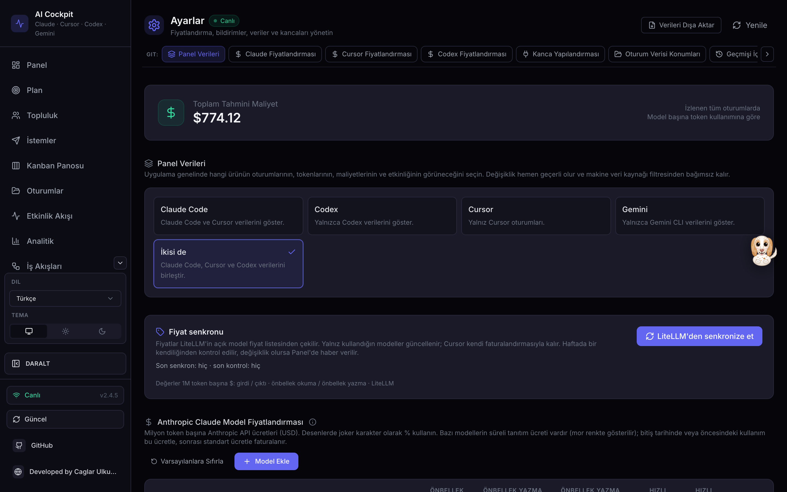

- **Fiyat senkronu**: "LiteLLM'den senkronize et" düğmesi açık model fiyat listesini çeker ve yalnız kullandığın modellerin eksik ya da farklı fiyatlarını günceller. Haftada bir kendiliğinden yalnız kontrol edilir; fark varsa Panel'de uyarı çıkar.
- **Dil**: kenar çubuğunun altında (Türkçe varsayılan; English, Español, 한국어, Tiếng Việt, 中文).
- **Tema**: kenar çubuğunun altında Sistem / Açık / Koyu.

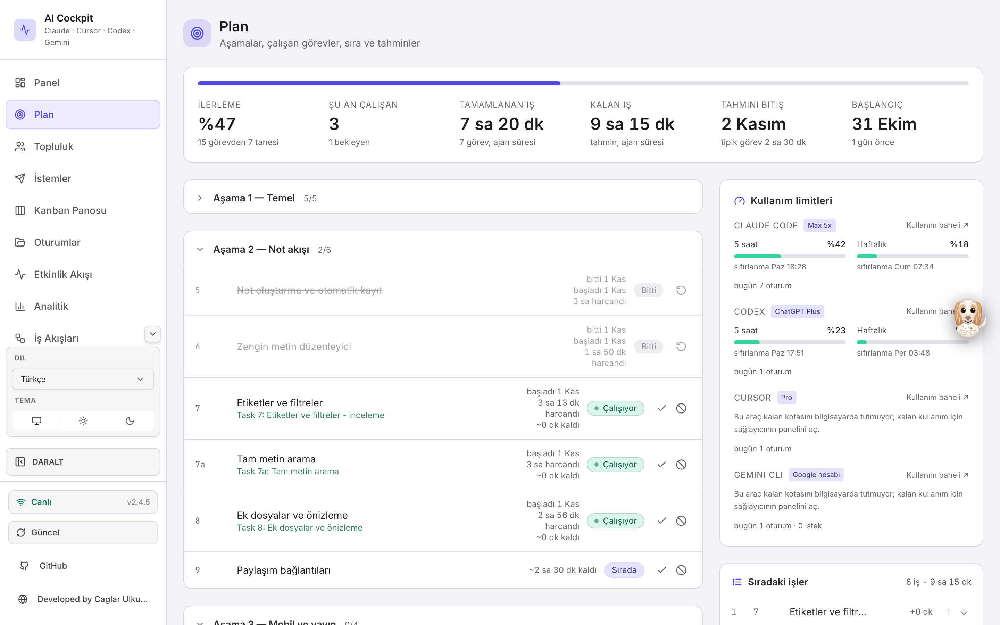

Telefonda kenar çubuğu ikon şeridine iner, dokununca açılır:

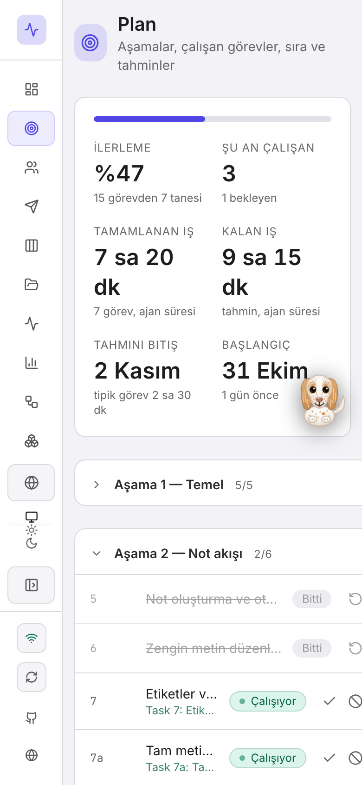

## 8. Başka bilgisayardan erişim ve uzak ajanlar

### Kokpiti başka cihazlardan açmak

Varsayılan mod budur; `ai-cockpit start` ya da `ai-cockpit restart` yeterli.

- Yerel adres `http://localhost:4820` olarak kalır ve dışarıya kapalıdır.
- Dış ağa **yalnız HTTPS** ile ayrı bir giriş açılır: `https://<ip>:4821`.
- İlk açılışta bu bilgisayar için bir sertifika, bir **erişim anahtarı** ve bir **hook anahtarı** üretilir (`~/.ai-cockpit/`, yalnız senin okuyabileceğin izinlerle).
- Başlatıcı her IP için `https://<ip>:4821/#token=…` bağlantısını ve sertifikanın **SHA256 parmak izini** yazar. Bağlantıyı diğer cihazda aç; tarayıcı bir kez sertifika uyarısı verir, parmak izi aynıysa kabul et. Anahtar tarayıcıda saklanır; anahtarsız gelene anahtar soran pencere çıkar.
- Tailscale açıksa ayrıca `https://<makine>.ts.net:8443` gerçek sertifikayla çalışır (tailnet'te Serve bir kez açılmış olmalı).
- Yalnız yerel çalıştırmak için: `ai-cockpit restart --local` (yalnız o çalıştırma için; sonraki `start` yine uzak modda açılır).

### Başka makinedeki ajanların olaylarını buraya göndermek

Ajanların çalıştığı makinede Node ya da kokpit gerekmez; tek dosyalık Go ajanı yeter:

```bash
# kokpitin olduğu makinede, bir kez:
cd ~/ai-cockpit/agent && ./build.sh --all      # dist/ altında macOS, Linux, Windows sürümleri

# ajan makinesinde (dosyayı kopyaladıktan sonra):
ai-cockpit-agent connect https://<kokpit-ip>:4821 <hook-anahtarı> <sha256-parmak-izi>
ai-cockpit-agent install       # Claude Code hook'larını ekler, önce yedek alır
ai-cockpit-agent status
```

- Hook anahtarı ve parmak izi `ai-cockpit start` çıktısında yazar.
- Veri yalnız HTTPS ile ve sabitlenmiş sertifikayla gider; parmak izi tutmazsa bağlanmaz.
- Kokpite ulaşılamazsa ajan asla beklemez.
- Kaldırmak için: `ai-cockpit-agent uninstall` ve `ai-cockpit-agent disconnect`.

## 9. Claude limitlerini bağlama

Claude Code kalan limitini yalnız durum satırına (statusline) verir. Bir kez `~/.claude/settings.json` içindeki `statusLine.command` değerini, mevcut komutunu sarmalayacak şekilde değiştir:

```json
"statusLine": {
  "type": "command",
  "command": "node \"/Users/<sen>/ai-cockpit/statusline/cockpit-tee.js\" -- \"<önceki statusline komutun>\""
}
```

Önceki durum satırın aynen çalışmaya devam eder; limitler `~/.ai-cockpit/claude-limits.json`'a yazılır ve Panel'de görünür.

## 10. Sorun giderme

| Belirti | Çözüm |
| --- | --- |
| Sayfa eski görünüyor | Tarayıcıda bir kez tam yenile (Cmd+Shift+R). |
| "Erişim anahtarı" penceresi çıkıyor | Uzak mod açık. `ai-cockpit start` çıktısındaki `#token=` bağlantısını aç ya da anahtarı yapıştır (`~/.ai-cockpit/dashboard-token`). |
| Diğer cihaz LAN IP'siyle bağlanamıyor | macOS: Sistem Ayarları > Gizlilik ve Güvenlik > Yerel Ağ'dan Node'a izin ver. Tailscale adresi bu izne takılmaz. |
| Tailscale adresi açılmıyor | Tailnet'te Serve kapalı olabilir; `~/.ai-cockpit/server.log` içindeki bağlantıdan bir kez aç. |
| Claude limitleri "bilinmiyor" | [Bölüm 9](#9-claude-limitlerini-bağlama)'daki durum satırı bağlantısı yapılmamış. |
| Plan'da süreler "—" | Ölçüm, `(est:…)` ve biten görev yok. Bir görevi "bitti" işaretle ya da başlıklara `(est:2h)` ekle. |
| Cursor görevi hemen bitiyor | Klasör güvenilir değil: "Bu klasöre güven (--trust)" kutusunu işaretle. |
| İstemde dosya içeriği yerine "(… dosyasından)" yazıyor | Dosya kokpitte ayarlı bir proje klasörünün içinde değil (güvenlik gereği okunmaz). |
| Kokpit açılmıyor | `ai-cockpit status`, sonra `tail -50 ~/.ai-cockpit/server.log`. |

---

Developed by Caglar Ulkuderner · GPL-3.0-or-later
